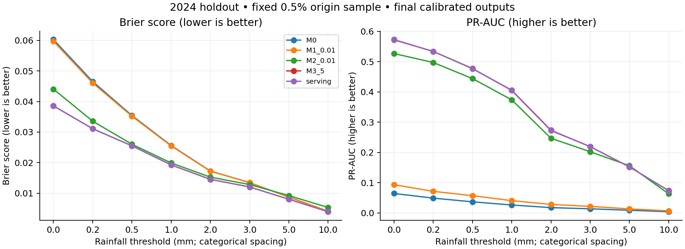
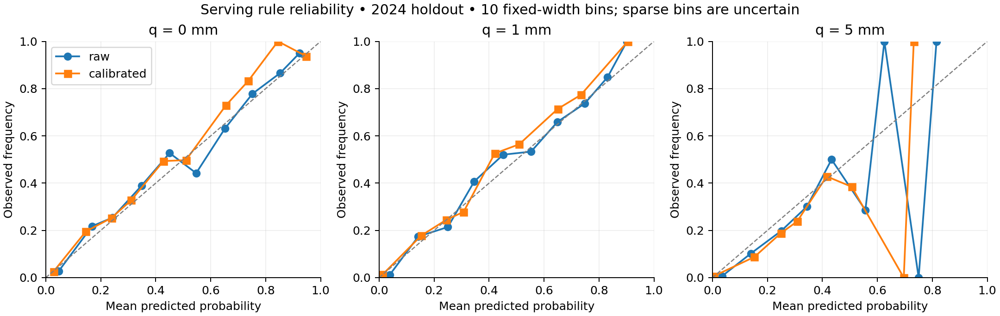
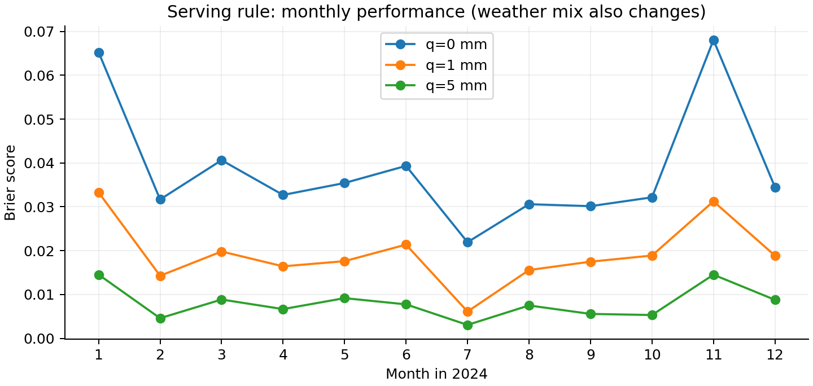

# Task 2 — C methods, results and limitations

**Version note:** all numerical results below describe frozen **v1**. A later [v2 interface revision](inference_v2.md) adds range guards, warnings and monotone postprocessing. Its corrected outputs are not evaluated by these v1 scores; the original evidence remains unmodified.

This is C's report contribution for run **c_available_v1**, executed on 6 October 2026. It is not the complete group report. Task 1, member names/student IDs, independent team checks and final PDF assembly remain group responsibilities. Full aggregate results are in [generated tables](../../reports/c_results/result_tables.md); the experiment definition is in [model protocol](model_protocol.md).

## Data acceptance and target correctness

We independently downloaded the 2017–2024 annual files, verified all eight SHA-256 hashes against A's manifest, and reused A's cleaning logic without modification. The output has **48,538,627 observations**, no duplicate station/time keys, and a cleaning log identical to A's. The difference from 48,538,713 raw rows is 86 same-value merged observations in 2017. This agreement supports reproducibility, not independent proof of every timestamp assumption.

Assuming interval-end timestamps, the target is rainfall accumulated at the same station over `(t,t+30 minutes]`, comprising exactly six five-minute slots. Strict exceedance is `R30 > q`; equality is negative. B identified a floating-point boundary defect in the foundation code. The correction preserves decimal sums at A's canonical 0.001-mm precision and compares integer units against `floor(q*1000)`. Thus 0.200+0.400 does not exceed 0.6, while a threshold immediately below 0.6 is correctly exceeded. A real S66 window at 2017-01-01 12:20 independently sums to 0.400 mm from the next six slots; current-slot rainfall is excluded. See [H1 evidence](../../reports/c_results/h1_acceptance.json).

Across the full clean table, **47,636,833** origins have complete future outcomes and **901,794** do not. Incomplete targets are unknown, never zero. Chronological boundaries additionally exclude 1,574 origins, of which 1,194 otherwise have complete outcomes. Full-grid origins are not manufactured where observations are absent, so conclusions are conditional on observed station/time origins and complete future outcomes.

## Features and temporal evaluation

Train on 2017–2022; use January–September 2023 for selection, October–December 2023 for calibration, and 2024 for the final test. Require the entire target horizon to remain inside its split. Fit station encoding and all estimators on training rows only. A label-independent, seeded hash selects 0.2% of training origins and 0.5% of other split origins. No class balancing is applied. All cleaned data are labeled; M0 uses all eligible training origins, while ML estimators use the sampled training population.

| Split | Eligible full-data origins | Sampled origins | Sampled stations | Expanded rows |
|---|---:|---:|---:|---:|
| Train | 34,542,285 | 69,149 | 88 | 414,894 (6 thresholds) |
| Validation | 5,044,031 | 25,227 | 73 | 201,816 (8 thresholds) |
| Calibration | 1,674,847 | 8,500 | 67 | 51,000 (6 thresholds) |
| Test | 6,374,476 | 31,798 | 70 | 254,384 (8 thresholds) |

The six fitting thresholds are 0, 0.2, 1, 2, 5 and 10 mm. Additional evaluation at 0.5 and 3 mm probes unseen thresholds; these values are not official warning categories. Threshold copies and nearby weather observations are correlated, not independent sample units.

Calendar inputs are station one-hot encoding, sine/cosine hour and day-of-year, and log(1+q). History adds exact lags at 5/10/15/30/60 minutes, missing flags, known-slot sums/counts/maxima/wet counts over 15/30/60 minutes, recent change, capped staleness and a no-history indicator. A historical observation must have event_time and available_at no later than t, known publication provenance and valid rainfall. Future amount/completeness, labels and publication timestamps are not model inputs.

This is a conservative **final-version availability proxy**, not an exact replay of every historical published version. With the cutoff enforced, no sampled origin has all twelve recent slots plus lag60 available. That is why feature_complete=false does not imply unusable features or exclusion. Mean known slots among twelve are 9.31 in training and 9.62 in test. The serving rule falls back to M1 when no usable recent history exists: **869/31,798 test origins (2.73%)**. Missing feature values are represented with explicit missing/count information rather than falsely treated as observed dry weather.

## Models, calibration and freeze

M0 is a per-threshold empirical training event probability. M1 is station/calendar/threshold logistic regression. M2 adds available history to logistic regression. M3 uses the M2 inputs in Spark GBT. LR regularization candidates are 0.01 and 0.1; GBT depths are 3 and 5, with 30 iterations. The primary criterion is equal-weight validation Brier over the six fitting thresholds, not the extra interpolation thresholds.

| Selected family | Validation mean Brier (raw) |
|---|---:|
| M0 reference | 0.027394 |
| M1, reg=0.01 | 0.027201 |
| M2, reg=0.01 | 0.021417 |
| M3, depth=5 | **0.019709** |

Calendar effects alone barely improve M0. Adding recent available rainfall materially improves predictions; GBT further improves on the linear history model in this fixed validation grid. GBT impurity importance ranks log_threshold (24.9%), sum_60 (13.4%), sum_30 (10.4%) and lag_15 (8.8%) highest. These are predictive associations, not causal contributions; correlated histories share information.

An increasing isotonic mapping is fitted separately for each family's winner, using only the 2023 calibration split, pooled across the six fitting thresholds. Raw and calibrated values are both retained; the predefined serving output is calibrated. Calibration-set scores are in-sample diagnostics, not holdout evidence. A probability cutoff of 0.5 is fixed for confusion metrics and is not an optimized alarm policy.

Models, source, config and sampled features were frozen at **2026-10-06 21:38:46 SGT**. Test evaluation started at 21:39:24 and completed at 21:40:05. The start/completion records reference the same frozen-manifest SHA-256. No test-driven refitting, parameter change, calibration change or monotonic postprocessing was applied.

## Final 2024 results

| Model / system | Six-threshold Brier, raw | Six-threshold Brier, calibrated |
|---|---:|---:|
| M0 | 0.027094 | Not applicable |
| M1 | 0.026953 | 0.026890 |
| M2 | 0.021440 | 0.021238 |
| M3 | 0.019959 | 0.019261 |
| Serving: M3 with M1 no-history fallback | 0.019956 | **0.019248** |

The frozen serving rule reduces this Brier summary by **28.96% relative to M0** on the sampled 2024 holdout. This is descriptive, not a significance claim. The fallback has a small aggregate impact because it applies to only 2.73% of origins. Calibration improves aggregate Brier in this run, but that does not imply perfect calibration at every threshold or in every subgroup.

At q=1 mm, test prevalence is 2.629%, Brier 0.019265, ROC-AUC 0.868869 and Spark trapezoidal PR-AUC 0.405617. At p>=0.5, precision is 65.0% but recall only 26.4%. At q=5 mm, recall drops to 2.14%; at q=10 mm, none of the 132 positive outcomes are detected at this cutoff (two false alarms). Therefore the model is not a satisfactory high-rainfall alarm system with the chosen cutoff, even though its ranking and probability scores improve on baselines. Accuracy alone would hide this failure.

At unseen q=0.5 and 3 mm, Brier is 0.025512 and 0.012077, respectively. These are limited interpolation checks, not evidence that all continuous thresholds are accurate. Tree responses are piecewise constant in the threshold feature.

The q=0 and q=1 curves broadly follow the diagonal, with visible deviations. High-probability bins at q=5 are very sparse: the 0.6–0.7 and 0.7–0.8 calibrated bins contain one observation each, so their apparent 0%/100% frequencies are not stable estimates. Isotonic calibration can output exact 0 or 1. One retained failure is S223, 2024-12-13 02:20, q=10: actual future rainfall 13.195 mm but calibrated probability 0. Another is S07, 2024-01-10 08:30, q=0: actual rain 0 but calibrated probability 1. Log loss is computed with explicitly documented numerical clipping at 1e-15; clipping does not change saved probabilities or excuse these confident errors.

Monthly errors also change with weather prevalence. For q=0, January and November Brier are 0.0652 and 0.0681, compared with July's 0.0219; event rates are respectively 13.77%, 11.58% and 2.87%. A lower monthly Brier can therefore reflect a drier/easier population, not necessarily a better fitted model. Station-level support and Brier are also retained in JSON; small station samples should not be treated as reliable station rankings.

## Important limitations and future work

1. **Threshold incoherence remains.** A valid exceedance curve should be non-increasing in q. On the eight-point test grid, calibrated serving predictions violate this in **104/222,586 adjacent comparisons (0.0467%)**, with a maximum increase of **0.2676 (26.76 percentage points)**. The maximum is substantial despite the low frequency. A monotone calibrator in raw score does not enforce monotonicity in rainfall threshold and can amplify an existing jump. This model is a probability-estimation prototype, not a coherent fitted rainfall distribution. A future, separately evaluated design should use a constrained survival/CDF model or a prospectively specified monotonic correction.
2. **Rare events and alarm decisions.** q=10 has only 264 training positives and 132 test positives at the origin level. Fixed p=0.5 yields zero test recall there. Larger label-independent samples, cost-based validation-only decision selection, and tail-specific validation deserve investigation; do not pick a new cutoff from these final test results.
3. **Availability and timestamp assumptions.** Final archived update fields do not reconstruct all earlier versions. Interval-end semantics remain an explicit assumption. Unknown publication times are excluded, and operational data may differ from this archive.
4. **Conditional coverage and dependence.** Missing origins and incomplete future windows are omitted from evaluable targets. Station coverage varies by year. Multiple thresholds, overlapping times and nearby stations are dependent; this work reports no naive independent-row confidence intervals.
5. **Limited predictors and tuning.** No radar, neighboring-station features or other meteorological predictors are included. The grid is small. Unknown stations use a safe encoding but geographic generalization is not established. q>10 is flagged extrapolation.
6. **No real-time service or full project completion claim.** Inference reads a local clean-history store. A production ingestion/monitoring service, Task 1 integration, full PDF and Canvas submission are outside this C run.

## Computing, reproducibility and AI

Execution used a local Apple M2 Pro (10 cores, 16 GiB RAM), macOS 15.7.7, Python 3.11.7, Spark 3.5.8 and Temurin JDK 17.0.20.1. ETL/model work used local[4], 4g driver memory and 32 shuffle partitions; reload/inference used local[2]/2g/4. Full cleaning took approximately 615 seconds, label/feature preparation 125.6 seconds, training plus validation 71.1 seconds and calibration 22.4 seconds. These are local elapsed times, not cluster scalability benchmarks. Full versions and configuration are recorded in [environment](../../reports/c_results/environment.md).

All feature construction, fitting, calibration and predictive evaluation use Spark DataFrames/MLlib. Matplotlib renders only bounded aggregated results. All candidate pipelines and winning calibrators are saved. In a new Spark session, a served prediction matches persisted batch raw/calibrated outputs within 1e-12; unknown-station/no-history fallback also passes. See [reload evidence](../../reports/c_results/reload_verification.json). This is C's automated check, not a claim that A or B has independently accepted H2.

After B's analysis merged into main, the combined suite passes **56 tests** (one dependency deprecation warning). C also ran B's independent metric implementation over all 201,816 M3 validation prediction rows: counts and confusion matrices match exactly, and Brier/log loss/ROC-AUC/PR-AUC match within 1e-12. See [cross-implementation evidence](../../reports/c_results/b_code_interoperability.json). The frozen source/model/feature hashes were preserved through this integration; no test-driven tuning occurred.

OpenAI Codex assisted implementation, local experiment execution, testing and report preparation. Human team members must review and take responsibility for the submission. The final PDF must include the detailed [AI usage declaration](ai_usage.md).
