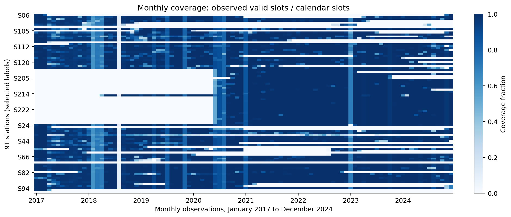
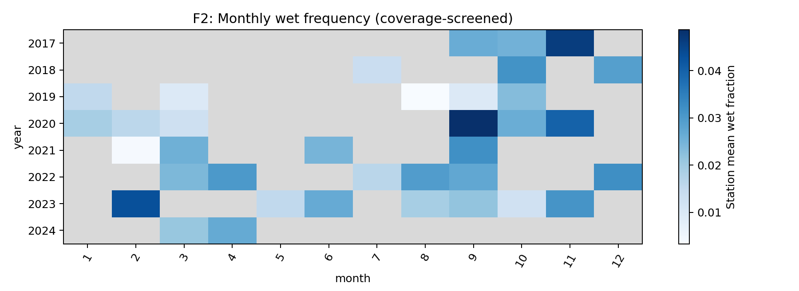
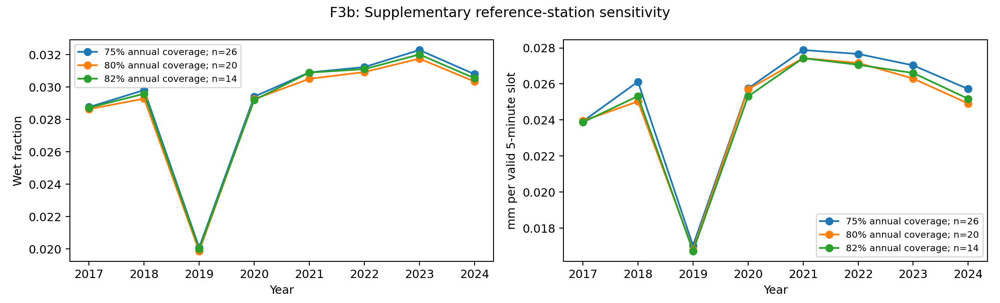
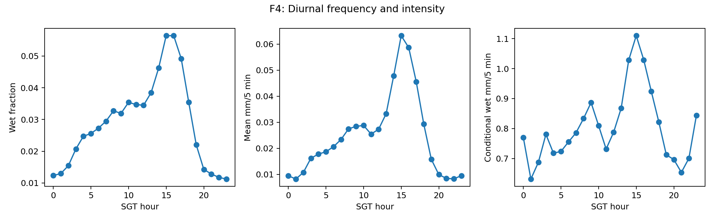
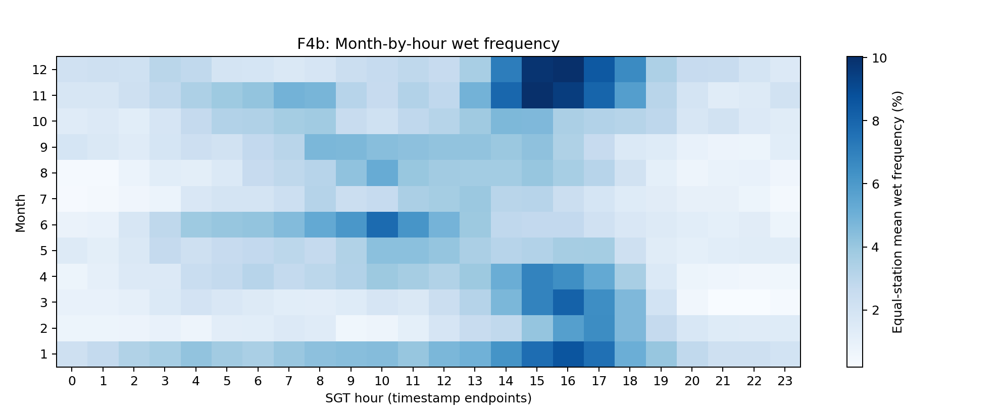
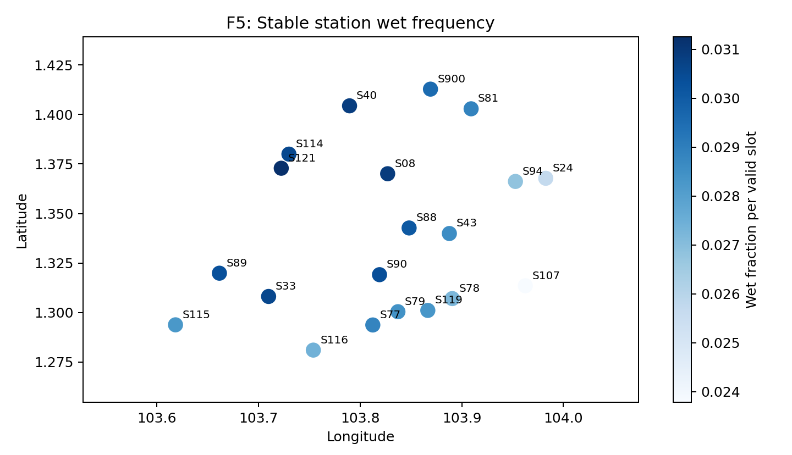

# Singapore rainfall patterns and 30-minute exceedance prediction

DSA5208 Project 2 | 2017-2024 annual rainfall records | 14 October 2026

| Group member | Student ID |
| --- | --- |
| Yikun Zhao | A0353894M |
| Zhou Jiahao | A0354090J |
| Chen Zheke | A0356140M |

### Abstract

We process eight annual Singapore rainfall datasets with Apache Spark and analyse within-year and across-year variation while explicitly accounting for missing observations and changing station coverage. The cleaned table contains 48,538,627 station-time records. A transparent 20-station reference set supports descriptive comparisons; strict monthly completeness criteria yield no eligible stations. Observed rain frequency peaks in the afternoon, but coverage gaps limit seasonal and long-term interpretations.

For 30-minute rainfall exceedance, we compare empirical, calendar, history-based logistic and gradient-boosted models in Spark MLlib with chronological selection and calibration. The frozen v1 serving system has a six-threshold mean test Brier score of 0.019248, compared with 0.027094 for the empirical baseline. A later monotone v2 interface scores 0.019246 on a separately labelled post-hoc evaluation of the same already-opened 2024 sample. Strong-rainfall recall remains poor at the fixed 0.5 alert cutoff.

### Submission contents

The submission contains the complete source code with a README explaining how to run it (README.md), the trained Spark MLlib pipeline models and isotonic calibrators (models/final/c_available_v1/), and this report. Every number in the report is traceable to tables, figures and review records under reports/. The original v1 experiment, frozen before the test year was evaluated, and the later v2 prediction interface are distinguished throughout.

---

## 1. Data and cleaning

Source [1] provides five-minute rainfall measurements, station information and observation times. We use the eight annual datasets from 2017 through 2024. The download manifest records annual dataset identifiers, source URLs, bytes and SHA-256 checksums. Independently reproduced downloads agree with the eight recorded checksums.

| Year | Raw records | Clean records | Same-value rows merged |
| --- | --- | --- | --- |
| 2017 | 5,256,106 | 5,256,020 | 86 |
| 2018 | 4,594,246 | 4,594,246 | 0 |
| 2019 | 5,026,862 | 5,026,862 | 0 |
| 2020 | 6,334,473 | 6,334,473 | 0 |
| 2021 | 7,044,646 | 7,044,646 | 0 |
| 2022 | 7,133,230 | 7,133,230 | 0 |
| 2023 | 6,742,890 | 6,742,890 | 0 |
| 2024 | 6,406,260 | 6,406,260 | 0 |

The raw total is 48,538,713 rows. Cleaning merges 86 same-value duplicate records in 2017, producing 48,538,627 rows with unique station/time keys. Rainfall is stored as Decimal(10,3); values with more than three decimals are rounded to 0.001 mm and flagged. Missing rainfall is not replaced by zero. Negative/non-numeric values, missing identifiers, unparseable timestamps and unresolved conflicts are rejected or quarantined by the pipeline; the actual counts are retained in the cleaning log.

If conflicting versions share a station/time key, the latest reading/update timestamps determine precedence; conflicting latest versions are isolated. The eight annual input files remain immutable. The cleaned table and all subsequent target/feature construction reuse this single shared pipeline.

### Time semantics and information availability

All analysis uses Asia/Singapore (UTC+08:00). Early 2017 observations ending in :59 are snapped upward by one second onto the five-minute grid. Other misalignment is not silently rounded. The interpretation of each reading as a five-minute interval ending at its timestamp is an explicit assumption: the supplied brief specifies five-minute measurements but does not independently establish the interval convention.

For historical prediction, available_at is the greatest of event time and the archived update timestamps. A feature is available only if both event time and available_at are no later than the prediction time, with recognised publication provenance. Archived final versions cannot reconstruct every earlier published version, so this is a conservative availability proxy rather than an exact live replay.

Sources: data/manifest.csv; docs/A/data_dictionary.md; docs/A/time_semantics.md; docs/A/decisions.md; reports/c_results/cleaning/cleaning_log.csv.

---

## 2. Computing environment and reproducibility

The project uses Python and PySpark DataFrame/SQL for processing, and pyspark.ml for feature pipelines, model fitting, calibration and predictive metrics. Matplotlib renders only bounded aggregate results and explicitly limited case windows. No distributed cloud cluster is claimed; all reported timings are local elapsed times.

| Stage / machine | Runtime | Spark configuration |
| --- | --- | --- |
| A: Apple M4, 10 logical cores, 16 GiB; macOS 15.7.3 | Python 3.11.15; Spark 3.5.8; JDK 17.0.20.1 | local[*]; 6g driver; 64 shuffle partitions |
| C: Apple M2 Pro, 10 cores, 16 GiB; macOS 15.7.7 | Python 3.11.7; Spark 3.5.8; JDK 17.0.20.1 | local[4]; 4g driver; 32 shuffle partitions |
| B: local review environment, recorded in validation.json | Python 3.11.16; Spark 3.5.8; local JDK 17 | local[4]; 4g driver; 8 shuffle partitions |

| Operation | Elapsed time / resource note |
| --- | --- |
| A downloads / cleaning / clean audit | 421 s / 629 s / 41 s; cleaning sampled peak process RSS about 4.7 GB |
| C label-feature preparation / training + validation / calibration | 125.6 s / 71.1 s / 22.4 s |
| B independent model review | 104.8 s; includes saved prediction metrics, subgroup checks and three model reload cases |
| Storage / reproducibility | Raw files about 7.5 GB. Raw and cleaned full data are not redistributed (reproducible with the download/cleaning scripts); trained models, sampled features and predictions are included |

These timings are from different recorded runs and machines and must not be interpreted as controlled scalability comparisons. A records machine and peak RSS evidence; C records its estimator timings. B's full platform string and exact review source hashes are in reports/b_model_review/validation.json. Task 1 aggregation used local[4] with a 6g driver.

### Independent checks

B recomputed all seven exported candidate validation datasets and all five final test datasets. Sample counts and TP/FP/TN/FN agree exactly; the largest absolute difference across checked floating-point metrics is 6.04e-14. The original frozen source/model/feature hashes remain unchanged. Three real v2 interface calls (false negative, false positive and no-history fallback) match the batch postprocessing within 1e-12 using B's local clean history and saved models.

A previously performed independent v1 model loading on a different machine: 200 sampled serving predictions and 10 interface calls matched the recorded results. These checks establish reproducibility for the cases tested, not universal correctness or causal validity.

Evidence: docs/A/environment.md; docs/A/model_review.md; reports/c_results/environment.md; reports/b_model_review/validation.json and independent_reload.json.

---

## 3. Task 1: coverage and comparability

We report wet frequency as positive-rain valid slots divided by all valid slots, and intensity both per valid five-minute slot and conditional on wet slots. A complete day has 288 expected slots. Station means are equally weighted; millimetres are not added across stations to invent a national rainfall total. The eight-year union contains 91 stations, with changing annual availability.

B independently reconciled all 8,736 station-month counts/coverage values with A. No station reaches even 90% coverage in every month across all eight years; the 95% and 98% sets are also empty. In August 2018, even the maximum station coverage is only about 7.53%. Low observed totals in such a month cannot be interpreted as drought.

A supplementary set uses stations with at least 80% annual coverage in each year and a single observed location/device: 20 stations. Thresholds of 75% and 82% yield 26 and 14 stations. This is a transparent alternative descriptive population, not a claim that the original strict monthly standard was met. Of 96 year-month cells, 60 are masked when any reference station has under 90% monthly coverage. Consequently, strong seasonal comparisons require caution.

---

## 4. Task 1: changes across years

| Year | Stations | Min. annual coverage | Mean wet frequency | Mean mm / valid slot | Mean observed mm / station |
| --- | --- | --- | --- | --- | --- |
| 2017 | 20 | 84.55% | 2.864% | 0.02395 | 2,378 |
| 2018 | 20 | 80.10% | 2.928% | 0.02503 | 2,183 |
| 2019 | 20 | 84.79% | 1.986% | 0.01680 | 1,670 |
| 2020 | 20 | 91.51% | 2.925% | 0.02570 | 2,582 |
| 2021 | 20 | 93.04% | 3.050% | 0.02743 | 2,817 |
| 2022 | 20 | 94.95% | 3.092% | 0.02717 | 2,827 |
| 2023 | 20 | 84.93% | 3.175% | 0.02630 | 2,632 |
| 2024 | 20 | 86.71% | 3.034% | 0.02491 | 2,509 |

Among the 20 reference stations, observed wet frequency is lowest in 2019 (1.986%) and highest in 2023 (3.175%). Average rainfall per valid slot is 0.01680 mm in 2019 and 0.02743 mm in 2021. Frequency and intensity therefore describe related but distinct aspects of observed rainfall. These are not rankings of complete annual rainfall totals.

The last column gives the mean rainfall actually recorded per reference station, about 1,670 mm in 2019 against 2,820-2,830 mm in 2021 and 2022. It is shown for scale only: it is not coverage-adjusted, so a year with more missing slots records less rain by construction. 2019 nevertheless stands out as the driest year on all three measures, while 2021-2023 are the wettest.

Dividing by observed time reduces differences in exposure, but does not remove bias if missingness depends on weather, station or time of day. The station set stays fixed across years; sensitivity curves show what happens under nearby coverage rules. Eight years of such conditional observations do not establish a long-term climate trend or a causal explanation involving urbanisation or large-scale climate drivers.

---

## 5. Task 1: within-year and spatial patterns

In the reference set, station-mean wet frequency peaks at 15:00-15:59 SGT (5.642%) and is lowest at 23:00-23:59 (1.123%). Afternoon observations are therefore more frequently wet in these data. Non-random hourly gaps and station differences remain possible explanations for part of the observed contrast; the analysis does not identify a physical mechanism.

The month-hour panel shows how the daily profile varies within the calendar year. It pools available observations by month/hour and is not subject to Figure 2's per-year/month masking; cells can therefore contain a different mix of years. It is a descriptive seasonal view, not an unbiased estimate of complete monthly rainfall or an independently established monsoon effect.

### Seasonal variation within the year

| Month | 1 | 2 | 3 | 4 | 5 | 6 | 7 | 8 | 9 | 10 | 11 | 12 |
| --- | --- | --- | --- | --- | --- | --- | --- | --- | --- | --- | --- | --- |
| Wet freq. | 4.3% | 2.0% | 2.4% | 2.8% | 2.6% | 3.1% | 1.9% | 2.3% | 2.7% | 2.7% | 4.1% | 3.7% |
| Peak hour | 16 | 17 | 16 | 15 | 10 | 10 | 13 | 10 | 08 | 14 | 15 | 16 |

Averaging the month-hour cells over the 24 hours gives a clear annual cycle. Observed wet frequency is highest from November to January (3.7-4.3%) and lowest in February and July (2.0% and 1.9%). The timing of rain also changes with the season. From November to April the wettest hour starts between 15:00 and 17:00 SGT, with a pronounced afternoon maximum. From May to September the peak moves to the morning (an hour starting between 08:00 and 10:00 SGT in May, June, August and September) and the afternoon maximum largely disappears. These observations are consistent in direction with the usual description of Singapore's climate: a wet early Northeast Monsoon (December-January) followed by a drier February, afternoon convective showers in the inter-monsoon months (April-May, October-November), and early-morning squall lines during the Southwest Monsoon (June-September). Our data alone do not establish those mechanisms.

---

## 6. Task 1: spatial variation and extreme checks

Reference-station wet frequency ranges from 2.378% at S107 to 3.125% at S121. The map reveals heterogeneity among observed sites. Coordinates with one device/location in the archive are a stability proxy, not externally verified station histories. Equal station weighting is not area weighting over Singapore.

### Extreme-window arithmetic and sensitivity

The clean table contains 47,636,833 observed origins with six complete future slots and 901,794 without a complete future window. Missing future values are unknown, not zero. B independently checked Decimal sums for three distinct station-day extreme candidates and preserved their neighbouring-station context. Adjacent top-ranked windows may belong to one event and must not be counted as independent storms.

One isolated candidate is S107 at 2022-08-21 19:55 SGT, with 85.6 mm in the next 30 minutes. Eight stations in the chosen rectangular neighbourhood have all 48 combined future slots recorded as zero. This is a reason for sensor/data scrutiny, not proof of error. Main results retain the reading. A separate sensitivity calculation excludes the six target slots as unknown and lowers the 2022 reference-set mean intensity by about 0.150%. Other anomalies may still exist.

Full extreme plots, denominators and sensitivity outputs are retained in reports/b_results/B_RESULTS.md and its csv/ and figures/ subdirectories. They describe observed extremes and are distinct from the predictive error cases in Section 11.

---

## 7. Task 2: target, features and experiment

Given station s, prediction time t and rainfall threshold q, estimate P(R(s,t,t+30 min) > q). The target sums exactly the next six five-minute slots in (t,t+30 min]; the current slot is excluded. A complete valid future is required. Strict equality to q is negative. Decimal-preserving accumulation and integer 0.001-mm comparisons repair the original floating-point boundary defect: 0.200+0.400 does not exceed 0.6.

| Split | Time interval | Sampled origins | Expanded rows |
| --- | --- | --- | --- |
| Train | 2017-2022 | 69,149 | 414,894 |
| Validation | Jan-Sep 2023 | 25,227 | 201,816 |
| Calibration | Oct-Dec 2023 | 8,500 | 51,000 |
| Test | 2024 | 31,798 | 254,384 |

The whole target horizon must remain within its split. A seeded, label-independent hash selects 0.2% of eligible training origins and 0.5% of other origins; no class balancing changes event prevalence. M0 uses all eligible training origins. Fitting uses q = 0, 0.2, 1, 2, 5 and 10 mm; evaluation also includes held-out threshold values 0.5 and 3 mm. Expanded rows are threshold copies, not independent origins.

| Feature block | Inputs and rationale |
| --- | --- |
| Calendar / station | Training-fitted station encoding; sine/cosine hour and day-of-year; log(1+q), allowing prediction to depend on threshold |
| Available history | Exact 5/10/15/30/60-minute lags; missing flags; known rainfall sums, counts, maxima and wet counts over 15/30/60 minutes |
| History condition | Recent change, staleness and no-history flag; unavailable slots are represented explicitly, not silently declared dry |

Only observations published by t enter features. Future rainfall, target completeness and labels are not predictors. Under the strict cutoff, all sampled feature_complete flags are false, yet the test sample averages 9.62 known slots out of 12. Excluding those rows would invalidate evaluation. The serving rule uses the history model when history is available and calendar M1 otherwise: 869 of 31,798 test origins (2.73%) fall back.

---

## 8. Task 2: models, calibration and v1 results

M0 is empirical training event probability by q. M1 is station/calendar logistic regression; M2 adds available history; M3 is a gradient-boosted tree model with the M2 inputs. LR regularisation candidates are 0.01/0.1; GBT depths are 3/5 with 30 iterations. Selection uses validation mean Brier over the six fitting thresholds. M3 depth 5 is selected; calendar information alone gives little improvement over M0.

A separate increasing isotonic calibration map for each family winner is fitted only on October-December 2023, pooling the six fitting thresholds. Model/source/config/feature files were frozen before v1 test evaluation on 6 October. All confusion metrics use the predefined p>=0.5 cutoff; this is not a tuned operational warning policy.

| v1 model / system | Mean Brier, raw | Mean Brier, calibrated |
| --- | --- | --- |
| M0 | 0.027094 | not applicable |
| M1_0.01 | 0.026953 | 0.026890 |
| M2_0.01 | 0.021440 | 0.021238 |
| M3_5 | 0.019959 | 0.019261 |
| serving | 0.019956 | 0.019248 |

The frozen v1 serving system lowers mean Brier by 28.96% relative to M0 on the sampled 2024 test population. This is a descriptive comparison, not a statistical significance claim. At q=1 mm, event prevalence is 2.629%, Brier 0.019265, ROC-AUC 0.868869 and PR-AUC 0.405617. Precision is 65.0%, but recall is only 26.4% at p>=0.5. At q=10 mm, none of 132 positive origins is detected and there are two false alarms. High accuracy would conceal this rare-event weakness.

---

## 9. v2: a separately evaluated interface revision

After the v1 test had been inspected, C introduced a guarded interface. It rejects unknown stations, dates outside the archive or a station's observed span, unaligned five-minute timestamps, and q outside [0,10] mm. Naive times mean SGT. Warnings identify calendar fallback and exact 0/1 estimates. This is an offline historical-data interface, not a future live-weather service.

v2 evaluates the same saved model/calibrator at six fixed q knots, projects them onto a non-increasing curve using equal-weight PAVA, and linearly interpolates in millimetres. Separate queries therefore use a consistent exceedance curve. No weights or calibration maps were refitted. B applied this already-fixed policy to the same 31,798 test origins and checked that all origins lie within the interface's supported domain.

| q (mm) | Events | v1 Brier | v2 Brier | v1 PR-AUC | v2 PR-AUC | v1 recall | v2 recall |
| --- | --- | --- | --- | --- | --- | --- | --- |
| 0 | 2047 | 0.038556 | 0.038551 | 0.572721 | 0.572837 | 43.2% | 43.2% |
| 0.2 | 1555 | 0.031097 | 0.031094 | 0.533442 | 0.533527 | 39.0% | 39.0% |
| 0.5 | 1169 | 0.025512 | 0.024917 | 0.476291 | 0.478121 | 43.0% | 33.1% |
| 1 | 836 | 0.019265 | 0.019268 | 0.405617 | 0.405296 | 26.4% | 26.4% |
| 2 | 559 | 0.014545 | 0.014534 | 0.273485 | 0.275828 | 16.5% | 16.5% |
| 3 | 435 | 0.012077 | 0.011839 | 0.218755 | 0.218824 | 17.9% | 8.0% |
| 5 | 281 | 0.008044 | 0.008044 | 0.152294 | 0.152296 | 2.1% | 2.1% |
| 10 | 132 | 0.003984 | 0.003984 | 0.073293 | 0.073493 | 0.0% | 0.0% |

The v2 six-fitting-threshold mean Brier is 0.01924570, versus 0.01924842 for v1. v1 has 104 upward probability violations among 222,586 adjacent q comparisons; v2 has zero on the evaluated grid. Structural coherence improves, but it does not imply uniformly better calibration, ranking or decisions. At q=0.5 and 3 mm, interpolation lowers Brier but also lowers recall at p>=0.5. q=10 recall remains zero.

### Evaluation integrity

These v2 results are explicitly post-hoc on an already-opened test sample. They are not fresh untouched-holdout evidence, and no new alert threshold or model was selected from them. v1 remains the original pre-test-frozen experiment. The submission includes both: v1 for frozen reproduction and v2 for the documented current interface, with separate scores and limits. Prospective performance of v2 requires new evaluation data.

The official brief does not specify a q range. The supported range of 0-10 mm is therefore a stated limitation of the delivered interface; we do not claim arbitrary-threshold or future-time coverage. Extending the supported tail would require additional modelling and validation, not silent clamping.

---

## 10. Probability calibration and subgroup errors

Sparse high-probability bins can show 0% or 100% outcomes by chance. For example, some v1 calibrated q=5 bins have only one observation. Isotonic calibration can output exact 0 or 1, which must not be interpreted as certainty. Log loss uses numerical clipping at 1e-15 only for scoring; stored probabilities are not altered.

The 15-minute state uses only known observations: observed dry does not mean unobserved slots were dry. An unknown state is retained. The lag5 state, station, month, fallback and source model are also retained in machine-readable results. Different subgroup event frequencies and support mean Brier comparisons alone cannot identify a causal model failure. Monthly error patterns are shown in the supplementary F11 figure.

---

## 11. Two real predictive failure cases

At S217, 2024-12-29T16:30:00+08:00, q=10 mm, actual next-30-minute rainfall is 46.689 mm. v1 estimates 0.080605; v2 estimates 0.080605. Both use the same p>=0.5 alert rule. Orange values occur after prediction and cannot be used as features; grey historical readings were not available at the prediction time.

At S07, 2024-01-10T08:30:00+08:00, q=0 mm, actual next-30-minute rainfall is 0.000 mm. v1 estimates 1.000000; v2 estimates 1.000000. Both use the same p>=0.5 alert rule. Orange values occur after prediction and cannot be used as features; grey historical readings were not available at the prediction time.

Selection is descriptive: the largest future accumulation among q=10 false negatives, and the highest-probability q=0 false positive, with deterministic station/time tie breaks. These examples explain limitations and were not used for tuning. Missing observations are marked separately from observed zeros. Publication-time restrictions can hide recent rainfall, and rainfall can also start or stop abruptly beyond the prediction origin.

---

## 12. Discussion, limitations and conclusion

Task 1 demonstrates afternoon wet-frequency concentration, observed interannual differences and station heterogeneity, while coverage analysis prevents gaps from being misrepresented as dry weather. The strict comparable-station failure is itself an important result. The alternative fixed reference set supports cautious description, not complete national totals or causal climate attribution.

Task 2 demonstrates that available recent rainfall is more predictive than calendar information alone in the tested grid. Spark MLlib pipelines and time-separated calibration produce better probability scores than the empirical baseline, but rare-event recall is poor. The v2 curve corrects threshold incoherence without resolving the underlying difficulty of anticipating severe rainfall.

### Limits affecting interpretation

Observed origins and complete future targets define a conditional evaluation population; absent calendar origins are not synthesised. Non-random missingness, changing stations, final-version publication proxies and uncertain interval semantics constrain validity. Nearby stations, overlapping windows and threshold copies are correlated. We report no independent-row confidence intervals or claims that 254,384 threshold rows are independent events.

The tuning grid is small and predictors omit radar and other meteorological information. Station encoding does not establish generalisation to unseen geography. The saved models were evaluated on historical archives, and the current interface restricts thresholds to 0-10 mm. Probability calibration and good aggregate Brier do not guarantee reliable high-rainfall alarms.

### Additional work

Future work could use validation-only cost-sensitive alarm selection, larger label-independent rare-event samples, coherent distributional models, richer available-at-time predictors, and independent prospective v2 evaluation. Day/week block bootstrap and a 30-minute-spaced origin sensitivity check could quantify dependence-related uncertainty.

### Conclusion

The two required analytical tasks are implemented with real 2017-2024 data and reproducible Spark workflows. Independent metric and model-loading checks support the reported evidence. The final interpretation remains deliberately limited to observed-data patterns, documented feature availability and version-specific historical prediction performance.

---

## 13. Delivery, contributions, AI and references

### Reproducing the work

README.md gives step-by-step commands. In short: install Python 3.11, Java 17 and the pinned requirements; download the eight annual datasets and run the cleaning pipeline (src/download_data.py, src/clean_data.py); run scripts/run_b_real.sh with a new output directory for Task 1; and run python -m src.task2.run prepare/train/calibrate/test to retrain Task 2 from scratch.

The trained models are included in the submission and need no download: models/final/c_available_v1/ holds the Spark PipelineModels (StringIndexer, OneHotEncoder, VectorAssembler and LogisticRegression or GBTClassifier) for every candidate, the isotonic calibrators of the family winners, selection.json and baseline.json. The saved validation, calibration and test predictions are in data/predictions/c_available_v1/ and the sampled feature tables in data/features/c_available_v1/. python -m scripts.review_b_models recomputes all reported metrics from these files without retraining.

python -m scripts.demo_predict_from_features S06 "2024-11-07 20:50:00" 1 loads the saved pipeline and calibrator, applies them to the stored prediction-time features of that sampled test origin and prints the exceedance probability, the observed outcome and the difference from the saved serving prediction (zero). It needs no raw data.

For an arbitrary query, python -m src.predict_safe S50 "2023-01-01 12:00:00" 1 returns the v2 probability for a station, prediction time and threshold. Because features are built from the station's recent readings, this command also needs the cleaned rainfall history (data/clean/clean_rainfall), which is produced by the download and cleaning steps above and is not redistributed because of its size.

This PDF and its editable Markdown version reports/GROUP_REPORT.md are generated by python -m scripts.build_group_report, which needs ReportLab and Pillow (requirements-report.txt).

### Contributions and AI usage

Throughout the report, A, B and C refer to the three members: A = Yikun Zhao (data acquisition, cleaning, quality audits, computing environment, integration and release); B = Zhou Jiahao (Task 1 exploration and figures, independent checks of the model results, and report writing/layout); C = Chen Zheke (Task 2 targets, features, Spark MLlib models, calibration, evaluation and the prediction interface).

OpenAI Codex assisted task planning, code implementation, debugging, real-data processing and experiment execution, automated tests, independent metric checks, figure generation and report drafting/layout. For B, assistance included coverage reconciliation, threshold-boundary review, v1 reproduction, v2 post-hoc evaluation and this report. C's detailed log additionally records feature, calibration and guarded-interface assistance. AI tools were also used for the final review of the submission and the revision of this report. AI-assisted code was verified with automated tests and independent recomputation of the reported metrics, and the group is responsible for the submitted content. Dated records of AI usage are in docs/ai_usage.md and docs/C/ai_usage.md.

### References and evidence index

[1] data.gov.sg. Historical Rainfall across Singapore, annual datasets 2017-2024. https://data.gov.sg/collections/2279/view. Exact annual sources and checksums: data/manifest.csv.

[2] DSA5208 Project 2 official assignment description, supplied course screenshot. Two Spark tasks; report contents; code/README, trained-model and named PDF deliverables; deadline 18 October 2026.

[3] Team implementation and evidence: https://github.com/ZYKuni/NUS_DSA5208_project2_submission (submitted version). Methods: docs/A/ and docs/C/model_protocol.md. Original frozen experiments: reports/c_results/.

[4] Task 1 aggregates: reports/b_results/csv/ and validation.json. Independent predictive audit and all report figures: reports/b_model_review/. AI records: docs/ai_usage.md and docs/C/ai_usage.md.

[5] Apache Spark MLlib: https://spark.apache.org/docs/3.5.8/ml-guide.html. Runtime and dependency records are included with the repository; the implementation uses Spark 3.5.8.

---

## Appendix A. Per-threshold probability scores

Each row has 31,798 observed origins with complete targets. Eight threshold rows for one origin are dependent copies. Spark trapezoidal PR-AUC is used, not average precision. Log loss clips probabilities only for numerical scoring at 1e-15. These complete tables supplement the model comparison and version discussion in Sections 8-9.

### Frozen v1 serving system

| q (mm) | N | Events | Rate | Brier | ROC-AUC | PR-AUC | Log loss |
| --- | --- | --- | --- | --- | --- | --- | --- |
| 0 | 31798 | 2047 | 6.438% | 0.038556 | 0.859604 | 0.572721 | 0.158791 |
| 0.2 | 31798 | 1555 | 4.890% | 0.031097 | 0.869067 | 0.533442 | 0.129512 |
| 0.5 | 31798 | 1169 | 3.676% | 0.025512 | 0.868555 | 0.476291 | 0.110598 |
| 1 | 31798 | 836 | 2.629% | 0.019265 | 0.868869 | 0.405617 | 0.082211 |
| 2 | 31798 | 559 | 1.758% | 0.014545 | 0.857848 | 0.273485 | 0.065983 |
| 3 | 31798 | 435 | 1.368% | 0.012077 | 0.849975 | 0.218755 | 0.056390 |
| 5 | 31798 | 281 | 0.884% | 0.008044 | 0.847693 | 0.152294 | 0.039591 |
| 10 | 31798 | 132 | 0.415% | 0.003984 | 0.847626 | 0.073293 | 0.030045 |

### v2 post-hoc on the already-opened 2024 sample

| q (mm) | N | Events | Rate | Brier | ROC-AUC | PR-AUC | Log loss |
| --- | --- | --- | --- | --- | --- | --- | --- |
| 0 | 31798 | 2047 | 6.438% | 0.038551 | 0.859607 | 0.572837 | 0.158780 |
| 0.2 | 31798 | 1555 | 4.890% | 0.031094 | 0.869069 | 0.533527 | 0.129506 |
| 0.5 | 31798 | 1169 | 3.676% | 0.024917 | 0.870702 | 0.478121 | 0.103312 |
| 1 | 31798 | 836 | 2.629% | 0.019268 | 0.868990 | 0.405296 | 0.082202 |
| 2 | 31798 | 559 | 1.758% | 0.014534 | 0.857806 | 0.275828 | 0.064962 |
| 3 | 31798 | 435 | 1.368% | 0.011839 | 0.854958 | 0.218824 | 0.054767 |
| 5 | 31798 | 281 | 0.884% | 0.008044 | 0.847694 | 0.152296 | 0.039591 |
| 10 | 31798 | 132 | 0.415% | 0.003984 | 0.847638 | 0.073493 | 0.030045 |

These results are descriptive estimates on the sampled population. The high-threshold low event rate explains why small Brier values can coexist with zero recall. The v2 table does not establish prospective generalisation, because the original test sample was already viewed before the interface revision.

---

## Appendix B. Counts at the fixed alert cutoff

The probability alarm cutoff is p>=0.5 for every row and version. It is separate from the rainfall amount q. TP/FP/TN/FN denote true positives, false positives, true negatives and false negatives. Counts, not only rates, make the missed-event and false-alarm burden explicit.

### Frozen v1 serving system

| q (mm) | TP | FP | TN | FN | Precision | Recall | F1 |
| --- | --- | --- | --- | --- | --- | --- | --- |
| 0 | 884 | 336 | 29415 | 1163 | 0.724590 | 0.431851 | 0.541169 |
| 0.2 | 606 | 225 | 30018 | 949 | 0.729242 | 0.389711 | 0.507963 |
| 0.5 | 503 | 328 | 30301 | 666 | 0.605295 | 0.430282 | 0.503000 |
| 1 | 221 | 119 | 30843 | 615 | 0.650000 | 0.264354 | 0.375850 |
| 2 | 92 | 82 | 31157 | 467 | 0.528736 | 0.164580 | 0.251023 |
| 3 | 78 | 96 | 31267 | 357 | 0.448276 | 0.179310 | 0.256158 |
| 5 | 6 | 9 | 31508 | 275 | 0.400000 | 0.021352 | 0.040541 |
| 10 | 0 | 2 | 31664 | 132 | 0.000000 | 0.000000 | 0.000000 |

### v2 post-hoc on the already-opened 2024 sample

| q (mm) | TP | FP | TN | FN | Precision | Recall | F1 |
| --- | --- | --- | --- | --- | --- | --- | --- |
| 0 | 884 | 336 | 29415 | 1163 | 0.724590 | 0.431851 | 0.541169 |
| 0.2 | 606 | 225 | 30018 | 949 | 0.729242 | 0.389711 | 0.507963 |
| 0.5 | 387 | 174 | 30455 | 782 | 0.689840 | 0.331052 | 0.447399 |
| 1 | 221 | 118 | 30844 | 615 | 0.651917 | 0.264354 | 0.376170 |
| 2 | 92 | 81 | 31158 | 467 | 0.531792 | 0.164580 | 0.251366 |
| 3 | 35 | 28 | 31335 | 400 | 0.555556 | 0.080460 | 0.140562 |
| 5 | 6 | 9 | 31508 | 275 | 0.400000 | 0.021352 | 0.040541 |
| 10 | 0 | 2 | 31664 | 132 | 0.000000 | 0.000000 | 0.000000 |

Full per-station and monthly original model aggregates remain in reports/c_results/. B independently reproduced month aggregates and added prediction-time known-rainfall, history-support, fallback and source-model groups in reports/b_model_review/. An AUC for any single-class subgroup is undefined, rather than zero or one.
