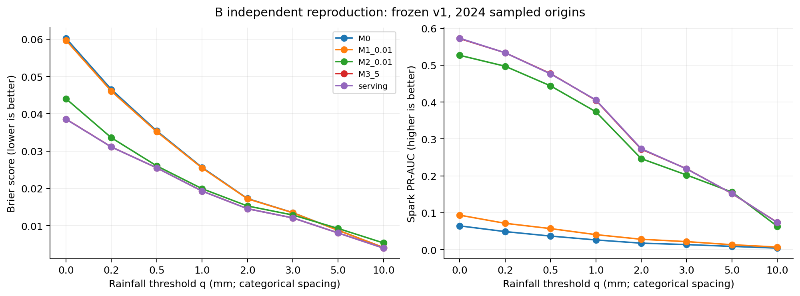
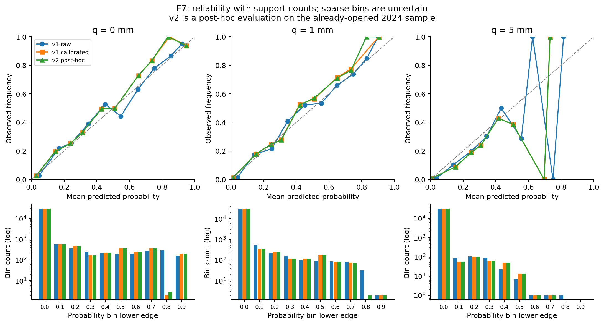
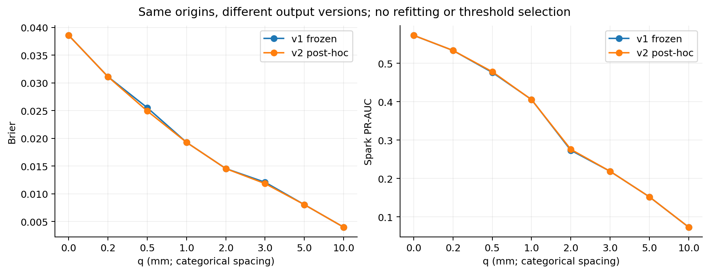
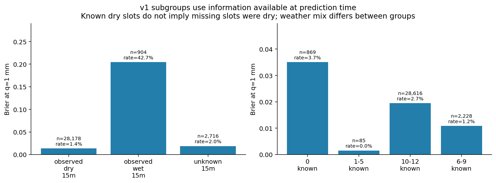
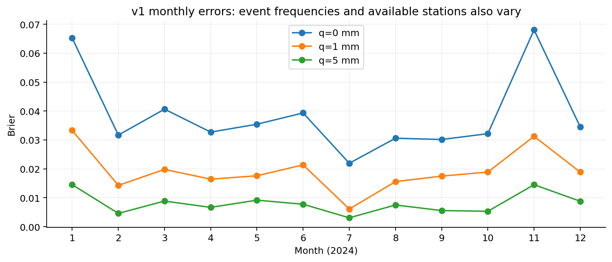
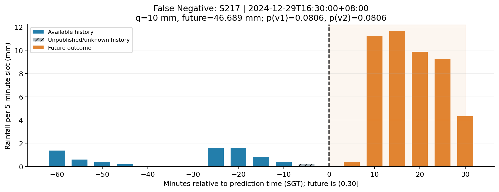
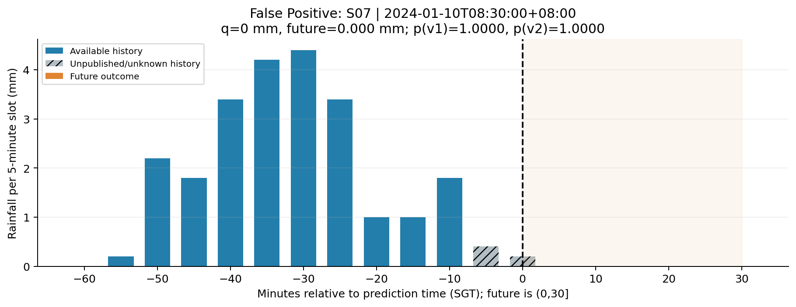

# B 独立模型复核与 Task 2 报告材料

真实 C 交付包已下载并校验；本材料来自 B 本机自动复算，不冒充组员已经完成人工签字验收。

## 版本与复核范围

v1 是 C 原始冻结实验；所有候选验证集和最终测试集的导出抽样预测均复算。v2 使用 C 已固定的六结点单调后处理；本次在已经查看过的 2024 样本上补充评估，没有拟合、调参或更换告警阈值，不能解释为新的未触碰留出集。

v1 六训练阈值宏平均 Brier=0.01924842；v2 补充评估=0.01924570。这两个数字必须标明各自版本。

| q (mm) | N | 正例 | v1 Brier | v2 Brier | v1 PR-AUC | v2 PR-AUC | v1 Recall | v2 Recall |
|---|---:|---:|---:|---:|---:|---:|---:|---:|
| 0 | 31798 | 2047 | 0.038556 | 0.038551 | 0.572721 | 0.572837 | 43.185% | 43.185% |
| 0.2 | 31798 | 1555 | 0.031097 | 0.031094 | 0.533442 | 0.533527 | 38.971% | 38.971% |
| 0.5 | 31798 | 1169 | 0.025512 | 0.024917 | 0.476291 | 0.478121 | 43.028% | 33.105% |
| 1 | 31798 | 836 | 0.019265 | 0.019268 | 0.405617 | 0.405296 | 26.435% | 26.435% |
| 2 | 31798 | 559 | 0.014545 | 0.014534 | 0.273485 | 0.275828 | 16.458% | 16.458% |
| 3 | 31798 | 435 | 0.012077 | 0.011839 | 0.218755 | 0.218824 | 17.931% | 8.046% |
| 5 | 31798 | 281 | 0.008044 | 0.008044 | 0.152294 | 0.152296 | 2.135% | 2.135% |
| 10 | 31798 | 132 | 0.003984 | 0.003984 | 0.073293 | 0.073493 | 0.000% | 0.000% |

## 图表与解释

可靠性图同时展示校准前、校准后及 v2 的概率箱样本量；精确数值见 reliability_counts.csv。少量样本的箱不能支持稳定校准结论。

分组只读取预测时可用特征；known_15m_state 用最近 15 分钟已知观测描述有雨/无雨/未知，不代表未发布的当前时隙。recent_state 另记录 lag5 可用状态。完整性按已知历史时隙数分组，feature_complete=false 不被剔除。原始分组数值见 stratified_metrics.json，含 N、正例、TP/FP/TN/FN、Brier 和召回率。

月份和站点组的天气发生率、观测支持不同，不能只凭 Brier 排名解释为模型跨组表现的因果差异。

## 真实错误案例

### false_negative：S217，2024-12-29T16:30:00+08:00

未来实际累计 46.689 mm；q=10 mm。v1 概率 0.080605，v2 概率 0.080605。告警阈值 p>=0.5。

### false_positive：S07，2024-01-10T08:30:00+08:00

未来实际累计 0.000 mm；q=0 mm。v1 概率 1.000000，v2 概率 1.000000。告警阈值 p>=0.5。

案例依据预先写入脚本的描述规则选择：q=10 的漏报中未来累计最大者，以及 q=0 的误报中概率最高者；按站点和时间确定并列顺序。用于解释错误，不用于调参。六个未来值用 Decimal 独立相加核对 C 的目标。灰色历史观测在预测时未发布，不能拿来解释为模型已经看到了它。

## 复现与交接

运行 `source scripts/b_env.sh`、`python -m scripts.review_b_models`、`python -m scripts.plot_b_model_review`。需要已校验的 C v2 模型包中的 models/features/predictions 和 A 清洗数据。原始 v1 冻结文件校验保持不变。详细对账见 validation.json，重载见 independent_reload.json。
